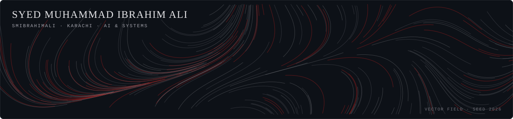

<div align="center">



<br/><br/>

<a href="https://www.linkedin.com/in/syed-muhammad-ibrahim-ali-7a4ba734b/"></a>&nbsp;
<a href="mailto:ialiibra2@gmail.com"></a>&nbsp;
<a href="https://github.com/smibrahimali"></a>

</div>

<br/>

### the year

<samp>

5th-semester BS Computer Science student at Dawood University of Engineering & Technology in Karachi, quietly obsessed with AI and machine learning — the kind of obsession that looks less like enthusiasm and more like staring at a loss curve until it makes sense.

Currently building local-first memory systems and full-stack AI applications alongside the IBM Machine Learning Professional Certificate. Believer in shipping over theorizing.

</samp>

<br/>

```python
class IbrahimAli:
    def __init__(self):
        self.name        = "Syed Muhammad Ibrahim Ali"
        self.university  = "Dawood University of Engineering & Technology"
        self.degree      = "BS Computer Science — 5th Semester"
        self.location    = "Karachi, Pakistan"
        self.status      = "awake at 3am, still debugging"

    def ambition(self):
        return "build things that learn faster than I do"
